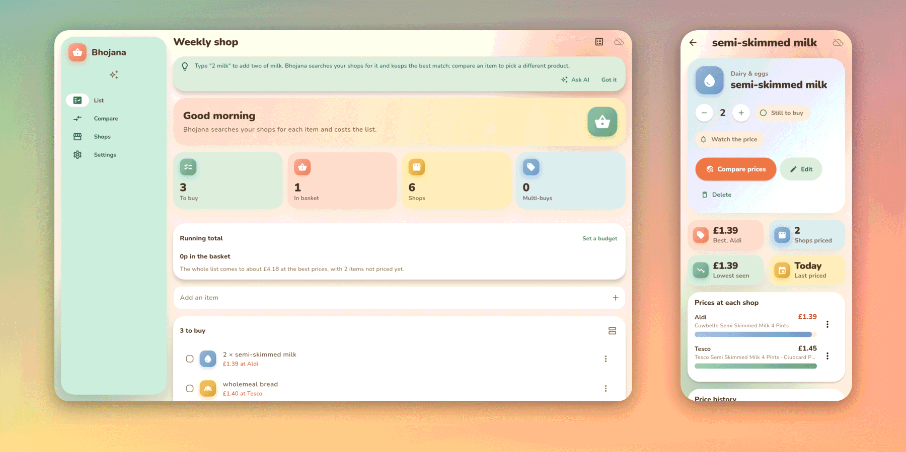
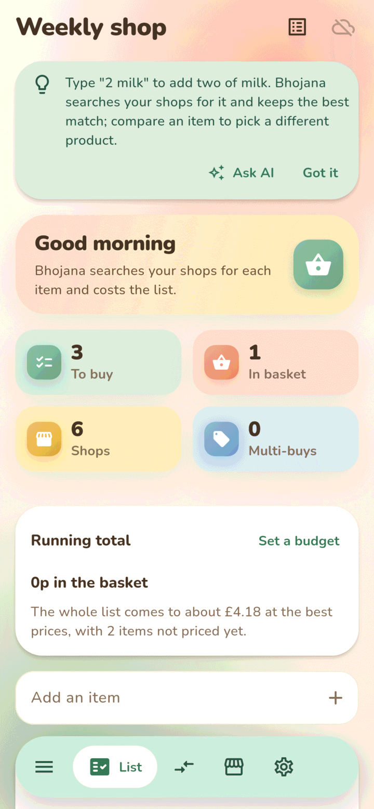
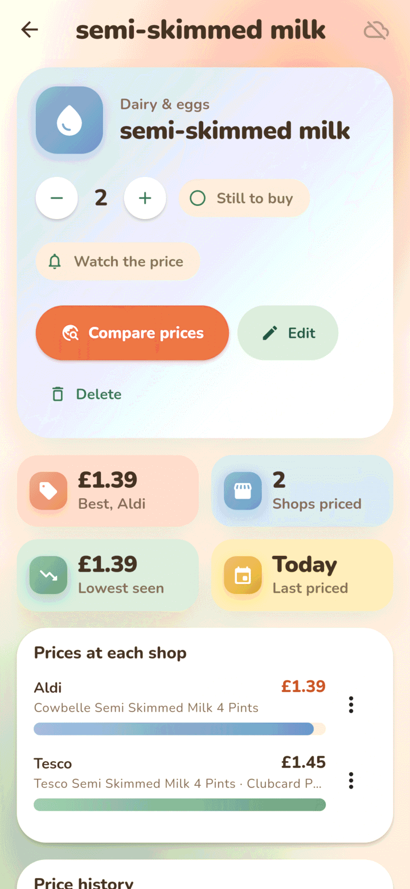
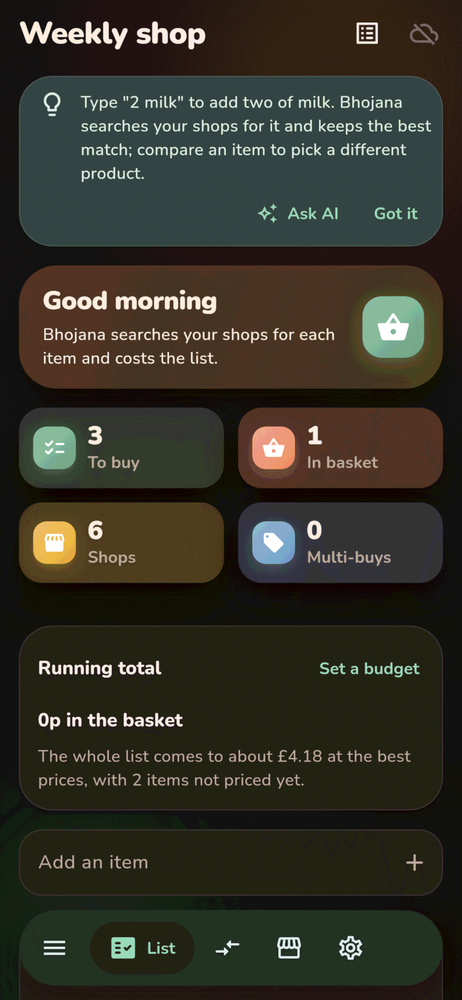
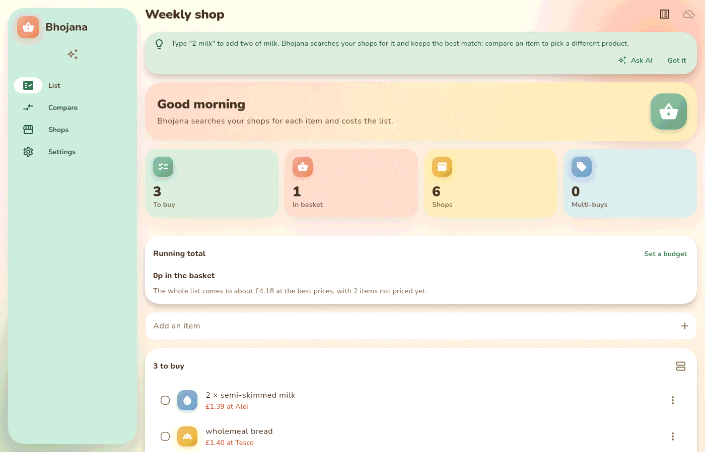
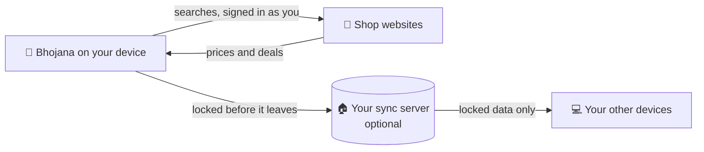

<h1 align="center">
  <br>
  <a href="https://github.com/sudharamachandranrajeev/bhojana"></a>
  <br>
  Bhojana
  <br>
</h1>

<h4 align="center">Your shopping list, priced at every UK shop you use, so you know where to shop and what you save.</h4>

<p align="center">
  <a href="https://github.com/sudharamachandranrajeev/bhojana/releases"></a>
  
  
  <a href="https://github.com/sudharamachandranrajeev/brahma"></a>
</p>

<p align="center">
  <a href="#-what-it-does">What it does</a> •
  <a href="#-get-started">Get started</a> •
  <a href="#-how-it-works">How it works</a> •
  <a href="#-faq-and-troubleshooting">FAQ</a> •
  <a href="#%EF%B8%8F-for-developers">For developers</a>
</p>

<p align="center">
  
</p>

Bhojana is a shopping list for people in the UK who want to pay less without checking ten websites.
Add an item and Bhojana looks it up at each shop you pick, using your own logins, so you see your
loyalty prices. Status: **early test releases** (0.x). Shop websites change often, so a shop may
stop reading until the next fix.

## ✨ What it does

- 📝 **Quick lists** – type `2 milk` to add two of milk. Tick items off, group them by aisle, and add
  past buys again with one tap.
- 💷 **Priced as you type** – each new item is looked up at every shop you starred. Bhojana keeps the
  best match at each, in the same pack size where it can.
- 🏆 **Where to shop** – names the cheapest shop for the whole list and what it saves over the next one.
- 💳 **Your own prices** – sign in to a shop inside Bhojana, and searches show your Clubcard, Nectar or
  Lidl Plus prices and local stock. Bhojana never sees your password or card details.
- 🏷️ **Multi-buys, your choice** – at Tesco, Asda and Iceland, deals like *Any 2 for £5* sit beside the
  single price. You pick **Take deal** or **Single price**.
- 🧺 **Fill a basket** – pick a shop and tap **Add all**. Bhojana adds each item to the shop's basket
  and lists anything it could not add. You check out yourself.
- 📉 **Price watch and budget** – each item has a page with its price at each shop and its price
  history. **Watch the price** flags drops, and **Set a budget** keeps a running total.
- 🛒 **22 shops** – Tesco, Sainsbury's, Asda, Morrisons, Ocado, Waitrose, Iceland, Co-op, Aldi, Lidl and
  12 more high-street shops, from Boots to Primark.
- 🌐 **On the web too** (optional) – open your lists in any browser, with a browser extension for live
  prices on a computer. ...and more.

## 📸 Screenshots

<table>
  <tr>
    <td align="center"><br><sub>Your list</sub></td>
    <td align="center"><br><sub>One item, every shop</sub></td>
    <td align="center"><br><sub>Dark mode</sub></td>
  </tr>
</table>

<p align="center">
  <br>
  <sub>The list on a desktop window</sub>
</p>

<sub>All screenshots show a made-up list, rendered from the current code.</sub>

## 🚀 Get started

### Step 1 – Download

Open the [releases page](https://github.com/sudharamachandranrajeev/bhojana/releases) and, under
the newest release, pick the file for your device:

| Your device | File to download | Works on |
| --- | --- | --- |
| 🤖 Android phone | `Bhojana-<version>-android.apk` | Android 7 and newer |
| 🪟 Windows computer | `Bhojana-<version>-windows-x64-setup.exe` | Windows 10 and 11 |
| 🐧 Linux computer | `Bhojana-<version>-linux-x64.tar.gz` | Ubuntu 24.04, Fedora, Arch and similar (Intel/AMD 64-bit) |
| 🧩 Browser extension | `bhojana-extension-<version>.zip` | Chrome, Edge, Brave, Firefox 128+ (only with the web app) |

Each release also has `SHA256SUMS.txt`, a list of fingerprints to check the files are genuine.

> [!NOTE]
> Android and Windows look up prices for you. The Linux download has no built-in browser, so shops
> open in your normal browser and you type in the prices you find.

### Step 2 – Install

<details>
<summary><b>🤖 Android</b></summary>

1. Open the downloaded `.apk` on your phone.
2. If Android asks, allow installs from your browser or file manager. This is normal for apps
   from outside the Play Store.
3. Tap **Install**, then **Open**.

Newer versions install over the top and keep your data.

</details>

<details>
<summary><b>🪟 Windows</b></summary>

1. Double-click `Bhojana-<version>-windows-x64-setup.exe`. No admin rights needed.
2. Windows may say *"Windows protected your PC"*. This appears because the app isn't paid-signed
   yet, not because it is harmful. Click **More info → Run anyway**.
3. Follow the installer, then open **Bhojana** from the Start menu.

Prefer no installer? Download `…-windows-x64-portable.zip`, unzip it anywhere and run `bhojana.exe`.

</details>

<details>
<summary><b>🐧 Linux</b></summary>

1. Open a terminal in the folder where the download landed.
2. Unpack it and run the installer as your normal user (not `sudo`):
   ```sh
   tar -xzf Bhojana-*-linux-x64.tar.gz
   cd bhojana-*-linux-x64 && ./install.sh
   ```
3. Open **Bhojana** from your app menu.

Bhojana needs a running keyring (GNOME Keyring or KWallet), which holds the key to your data. To
remove it, run `./install.sh --uninstall`. Your data stays.

</details>

### Step 3 – First launch

1. Bhojana asks **where your data should live**. Pick **Keep everything on this device** to start.
   You can turn on sync later in **Settings**.
2. Open **Shops**. Tap the ☆ star on each shop you use, and set **Your postcode**.
3. Tap **Sign in to** a shop (the arrow on its row) to see your loyalty prices.
4. Go back to **List**, type an item into **Add an item**, and watch the prices arrive.
5. When the list is ready, tap **Fill a basket**, pick a shop, then **Add all**.

### Step 4 (optional) – Sync and the web app

- **Sync between devices**: set up the free [Brahma sync server](https://github.com/sudharamachandranrajeev/brahma/tree/main/server)
  at home or on Cloudflare. Then choose **Settings → Set up sync** and follow the steps. The same
  account works in every Brahma app.
- **Use it in a browser**: the web app runs on Bhojana's own older server ([server/](server/README.md)),
  not yet on the Brahma server. Its guide is in [web/README.md](web/README.md). To get live prices
  there, add the [browser extension](extension/README.md).

## 🧭 How it works



- **Bhojana reads each shop's own search page**, in a hidden browser on your device, using your
  sign-in. No Bhojana company server sits in between.
- **Your list is encrypted on the device.** Sync is optional; the server only holds data it cannot
  read.
- **Bhojana contacts shop websites only** when you search, compare or open a shop.
- **It never checks out for you.** It adds items to the basket and stops there.

## ❓ FAQ and troubleshooting

<details>
<summary><b>A shop shows no price, or asks if I am a person</b></summary>

Big supermarkets block automatic browsing. Open the shop from **Shops**, accept its cookie banner or
sign in, answer any check, then tap **Check prices** again. *Where to shop* tells you when a shop
wants this.
</details>

<details>
<summary><b>Does Bhojana see my shop password or card?</b></summary>

No. You sign in on the shop's own page. Bhojana keeps that page's cookies on your device, so later
searches use your session. It never stores passwords or card details.
</details>

<details>
<summary><b>Why does Linux make me type prices?</b></summary>

The Linux download has no built-in web browser, because Ubuntu ships no WPE WebKit. If you build
from source on a system that has it (Arch or Fedora), Linux gets the full lookup too.
</details>

<details>
<summary><b>Windows says the app might be unsafe</b></summary>

The build isn't code-signed (a paid certificate). Click **More info → Run anyway**. Check the file
against `SHA256SUMS.txt` on the release if you want to be sure it is genuine.
</details>

<details>
<summary><b>Where is my data stored?</b></summary>

Linux: `~/.local/share/dev.brahma.bhojana`. Windows: under `%APPDATA%`. Android: inside the app.
Uninstalling on Android deletes it, so sync first if you want to keep your lists.
</details>

<details>
<summary><b>Can I use Bhojana inside the Brahma app?</b></summary>

Yes. [Brahma](https://github.com/sudharamachandranrajeev/brahma) includes Bhojana alongside the
other family apps, with one sign-in for all of them.
</details>

## 🛠️ For developers

<details>
<summary>Build from source, test and release</summary>

You need [Git](https://git-scm.com) and [Flutter](https://flutter.dev) 3.47. The web app, server
and extension need Node.js 24 or newer.

```bash
git clone https://github.com/sudharamachandranrajeev/bhojana
cd bhojana
flutter pub get
flutter run -d linux        # or windows, or an Android device

flutter test                                              # reader_test uses headless Chromium if installed
flutter test integration_test/live_app_test.dart -d linux # the whole flow against the real shops
flutter test integration_test/live_shops_test.dart -d linux --dart-define=SHOPS=asda,iceland
                                  # saves real shop pages to test/live_pages (not committed);
                                  # flutter test then replays the reader over them offline
BHOJANA_SHOTS=/tmp/shots FLUTTER_ROOT=<flutter sdk> flutter test test/screenshots_test.dart
(cd server && npm ci && npm test)  # older sync server
(cd web && npm ci && npm test)     # web app
```

- Shop search addresses live in `lib/domain/shops.dart`. The price reader is one script for every
  site, in `lib/domain/reader.dart`: it reads schema.org Product data, or product tiles with a £
  price.
- Linux builds get the in-app browser when WPE WebKit is installed (`pacman -S wpewebkit` on Arch,
  `wpewebkit` on Fedora).
- A `v*` tag builds, smoke-tests and publishes the Android, Windows and Linux builds and the
  extension zip (`.github/workflows/release.yml`). Changes per version: [CHANGELOG.md](CHANGELOG.md).

</details>

## Related

Bhojana is one app in the **Brahma** family. They share one sign-in and one sync server.

| App | What it does |
| --- | --- |
| [brahma](https://github.com/sudharamachandranrajeev/brahma) | The shared core and the all-in-one app |
| [artha](https://github.com/sudharamachandranrajeev/artha) | Money: accounts, spending, bills and investments |
| [graha-anveshana](https://github.com/sudharamachandranrajeev/graha-anveshana) | Find a home to rent or buy |
| [vahana-anveshana](https://github.com/sudharamachandranrajeev/vahana-anveshana) | Find a car |
| [udyoga](https://github.com/sudharamachandranrajeev/udyoga) | Career and job hunting |
| [vidya](https://github.com/sudharamachandranrajeev/vidya) | Learning, flashcards and focus |
| [vani](https://github.com/sudharamachandranrajeev/vani) | Social media posts, inbox and alerts |

## License

No licence has been chosen yet; all rights reserved.

---

> GitHub [@sudharamachandranrajeev](https://github.com/sudharamachandranrajeev)
